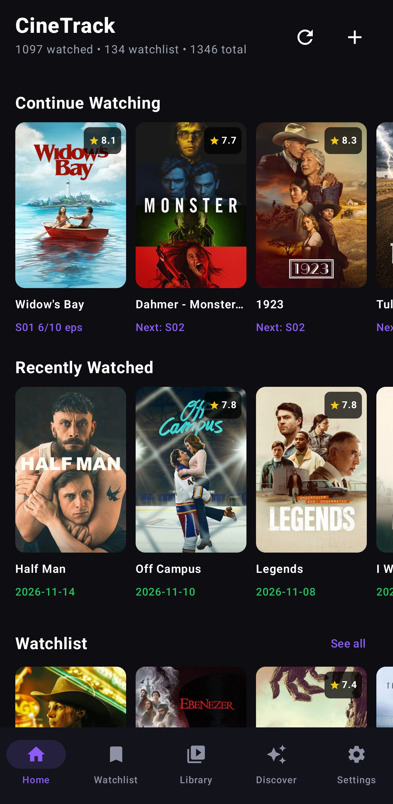
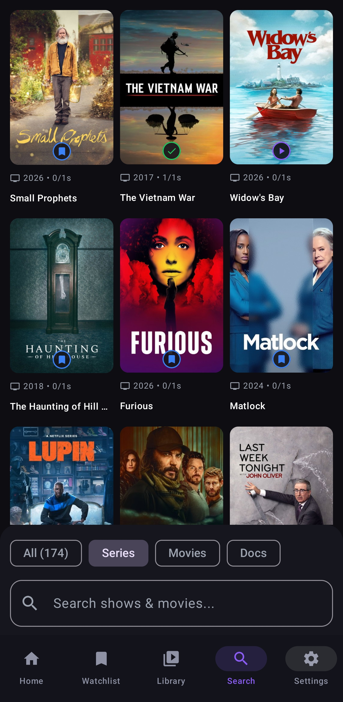
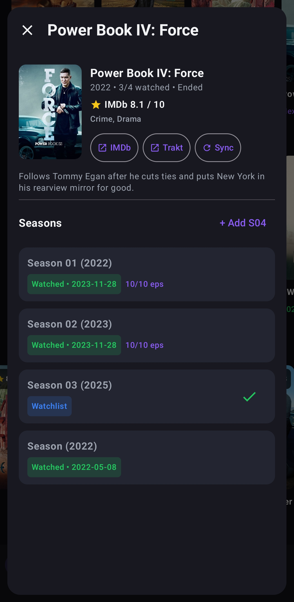
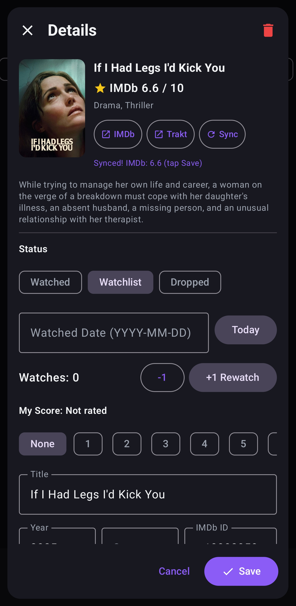

# 🎬 CineTrack

-3DDC84?logo=android&logoColor=white)

> **Personal offline-first Android tracker for movies, TV series by season, and watchlists — featuring AI-powered "For My Taste" discovery (Firebase AI Logic + Google Search, TMDB, Trakt, IMDb & Rotten Tomatoes context), Trakt.tv 1-way sync, and OMDb/TMDB enrichment.**

[🇬🇧 English](#english) • [🇻🇳 Tiếng Việt](#tiếng-việt)

---

## 📸 Screenshots

> *Legacy MovieTracker UI preview (dark theme)*

| Home & Continue Watching | 3-Column Poster Grid (Search) | Series Season Tracker | Details (IMDb & Trakt) |
| :---: | :---: | :---: | :---: |
|  |  |  |  |

---

## 🇬🇧 English

### ✨ Features
- **✨ Discover → For My Taste (AI Curator):**
  - Powered by **Firebase AI Logic (Gemini)** with **Google Search Grounding** and **Firebase App Check**.
  - **2 Recommendation Modes:** *Trending & For Me* (combines live TMDB Trending, Trakt Trending/Popular, and Google Search across IMDb & Rotten Tomatoes charts) and *Best Taste Match* (deep taste matching based on your ratings and rewatches).
  - **Custom Mood / Genre Prompt:** Ask follow-up questions in natural language (e.g., *"short psychological thriller"* or Vietnamese prompts) tailored to your personal library.
  - **Strict Library Filtering:** Automatically excludes titles already in your Watched, Watchlist, Dropped, or Ignored lists—both before and after API enrichment.
  - **Actionable Picks:** Every card in *Recommended Picks* supports **+ Watchlist**, direct **IMDb** lookup, **Options** (custom status/rating), and **Ignore** (persisted locally with **Undo** / **Ignored** manager dialog so AI avoids those titles and similar picks in future runs).
- **Offline-First SQLite Library:** Instant search across titles, IMDb IDs (`tt...`), genres, release years, and personal notes without needing an internet connection.
- **Trakt-Inspired Dark UI (5-Tab Navigation):**
  - **Home:** *Continue Watching* carousel (in-progress series and shows with newly aired watchlist seasons), *Recently Watched*, and *Watchlist* picks.
  - **Watchlist & Library:** Filter by status (`Watched`, `Watchlist`, `Dropped`) and type (`Movie`, `Series`, `Documentary`), switch between **3-Column Poster Grid** and **Detailed List**, and sort **Ascending (`↑`) / Descending (`↓`)** by Updated, Watched Date, IMDb Rating, My Score, Year, or Title.
  - **Discover (`For My Taste` + `Library & Web`):** Switch seamlessly between AI recommendations and full-screen 3-column library/online poster search.
  - **Settings:** Centralized API keys, Trakt sync, CSV/JSON import-export, and backup controls.
- **Grouped Series Tracking:** Automatically groups seasons (`S01`, `S02`, ...) under a single show with progress bars, quick mark-watched actions, `+ Add Season`, and TMDB season sync.
- **Trakt.tv 1-Way Sync (Device Code / PKCE Flow):**
  - Pulls watched movies, season/episode progress (`Watching: 5/12 eps`), watchlist, and ratings without modifying your Trakt account.
  - Connects using only **Client ID** (supports secret-less PKCE apps), plus optional 3-hour background sync on launch.
- **Auto-Check New Seasons (TMDB):** Runs daily in the background (or manually), automatically adding newly aired seasons to your Watchlist while skipping `Dropped` and `Ended`/`Canceled` series.
- **OMDb & TMDB Enrichment:** Fetches IMDb ratings, genres, plots, and caches posters locally on the device; includes a 100-entry batch fetcher.
- **Android Share Sheet Support:** Share any IMDb link or title from Chrome or the IMDb app directly to **CineTrack** to check watch history or add to your watchlist.
- **Backup & Google Drive Export:** Auto-backup JSON to a selected folder after every change, 1-tap `Send to Drive`, manual JSON backup/restore, and CSV export.

### 🛠 Tech Stack
- **Language & UI:** Kotlin, Jetpack Compose (Material 3)
- **AI & Security:** Firebase AI Logic (`firebase-ai`), Google Search Grounding, Firebase App Check
- **Local Storage:** SQLite (`SQLiteOpenHelper`) + `SharedPreferences` + local poster file cache
- **Networking:** Built-in `HttpURLConnection` + `org.json`
- **CI/CD:** GitHub Actions (`gradle assembleDebug`)

### 🔑 API & Firebase Setup
1. **OMDb API Key** *(IMDb ratings, genres, plot)*: Get a free key (1,000 req/day) at [omdbapi.com/apikey.aspx](https://www.omdbapi.com/apikey.aspx).
2. **TMDB API Key** *(posters, search, live trending, new season tracking)*: Get a free key/token at [themoviedb.org](https://www.themoviedb.org/settings/api).
3. **Trakt Client ID** *(1-way sync + Trakt Trending/Popular feed)*: Create an app at [trakt.tv/oauth/applications/new](https://trakt.tv/oauth/applications/new) with Redirect URI `urn:ietf:wg:oauth:2.0:oob`. Paste your **Client ID** in Settings.
4. **Firebase (`google-services.json`):** Required for **For My Taste** AI recommendations (`app/google-services.json` is excluded from GitHub sync for security).

### 🚀 Build APK via GitHub Actions
1. In your GitHub repository, open **Settings → Secrets and variables → Actions → Repository secrets** and add `GOOGLE_SERVICES_JSON` containing the JSON content of your `app/google-services.json`.
2. Push to `main` (or trigger **Build Android APK** manually from the **Actions** tab).
3. Download **`MovieTracker-APK`** under **Artifacts**, unzip, and install `app-debug.apk` on Android 7.0+ (API 24+).

---

## 🇻🇳 Tiếng Việt

### ✨ Tính năng chính
- **✨ Discover → For My Taste (Gợi ý phim thông minh bằng AI):**
  - Sử dụng **Firebase AI Logic (Gemini)** kết hợp **Google Search Grounding** và **Firebase App Check**.
  - **2 chế độ gợi ý:** *Trending & For Me* (kết hợp dữ liệu **TMDB Trending**, **Trakt Trending/Popular** và tìm kiếm web từ bảng xếp hạng **IMDb / Rotten Tomatoes**) và *Best Taste Match* (ưu tiên hợp gu nhất dựa trên điểm chấm & số lần xem lại).
  - **Khung hỏi thêm theo tâm trạng/thể loại:** Nhập trực tiếp yêu cầu tự nhiên bằng tiếng Việt hoặc tiếng Anh ngay dưới đáy màn hình.
  - **Lọc trùng tuyệt đối:** Tự động loại bỏ toàn bộ phim đã xem, đang trong Watchlist, đã Dropped hoặc đã Ignore trước khi gọi AI và cả sau khi đối chiếu dữ liệu IMDb/TMDB.
  - **Thao tác nhanh trên từng phim gợi ý:** Mở thẳng trang **IMDb** để xem thông tin, bấm **+ Watchlist**, tùy chỉnh trạng thái (**Options**), hoặc bấm **Ignore** (lưu vĩnh viễn + dạy AI tránh gợi ý lại phim đó và phim tương tự, hỗ trợ **Undo** và hộp thoại quản lý **Ignored**).
- **Kho phim Offline siêu nhanh (SQLite):** Tìm kiếm tức thì theo tên phim, mã IMDb (`tt...`), thể loại, năm phát hành và ghi chú cá nhân mà không cần mạng.
- **Giao diện tối 5 tab (Home / Watchlist / Library / Discover / Settings):**
  - **Home:** *Continue Watching* (Series đang xem dở & Series có mùa mới trong Watchlist), *Recently Watched* và *Watchlist*.
  - **Watchlist & Library:** Lọc theo trạng thái (`Watched`, `Watchlist`, `Dropped`), loại (`Movie`, `Series`, `Documentary`); chuyển đổi giữa **Lưới Poster 3 cột** và **Danh sách chi tiết**; sắp xếp **Tăng dần (`↑`) / Giảm dần (`↓`)**.
  - **Discover:** Gồm tab **For My Taste** (AI gợi ý) và **Library & Web** (tìm kiếm lưới poster 3 cột trong kho offline lẫn TMDB/OMDb online).
  - **Settings:** Quản lý API key, đồng bộ Trakt, nhập/xuất CSV/JSON và sao lưu.
- **Quản lý Series theo nhóm mùa:** Tự động gộp `S01, S02...` về cùng một bộ phim với thanh tiến độ, đánh dấu nhanh từng mùa, thêm mùa mới và đồng bộ danh sách mùa từ TMDB.
- **Đồng bộ 1 chiều từ Trakt.tv (Device Code / PKCE):** Kéo lịch sử phim đã xem, tiến độ xem dở từng mùa (`Watching: 5/12 eps`), Watchlist và điểm cá nhân về app chỉ với **Client ID** (hỗ trợ tự động đồng bộ mỗi 3 tiếng).
- **Tự động kiểm tra mùa mới (TMDB):** Quét mỗi ngày 1 lần (hoặc bấm tay) để tự thêm các mùa mới đã phát sóng vào Watchlist, tự bỏ qua các bộ đã `Dropped` hoặc `Ended`/`Canceled`.
- **Tích hợp OMDb & TMDB:** Tự động tải điểm IMDb, thể loại, tóm tắt, lưu đệm Poster offline và tải bù hàng loạt 100 phim/lượt.
- **Chia sẻ trực tiếp (Android Share Sheet):** Bấm *Share* từ Chrome hoặc app IMDb sang **CineTrack** để kiểm tra nhanh đã xem chưa hoặc lưu vào Watchlist.
- **Sao lưu & Google Drive:** Tự động ghi file JSON vào thư mục đã chọn sau mỗi thay đổi, gửi nhanh lên Google Drive với 1 chạm (`Send to Drive`), sao lưu/khôi phục JSON và xuất CSV.

### 🔑 Thiết lập API & Firebase
1. **OMDb API Key:** Đăng ký miễn phí (1.000 lượt/ngày) tại [omdbapi.com/apikey.aspx](https://www.omdbapi.com/apikey.aspx).
2. **TMDB API Key:** Tạo tài khoản miễn phí tại [themoviedb.org](https://www.themoviedb.org/settings/api) để lấy API Key hoặc Read Access Token.
3. **Trakt Client ID:** Tạo app tại [trakt.tv/oauth/applications/new](https://trakt.tv/oauth/applications/new) với Redirect URI `urn:ietf:wg:oauth:2.0:oob`, dán **Client ID** vào Settings để bật cả đồng bộ Trakt lẫn nguồn *Trakt Trending/Popular*.
4. **Firebase (`google-services.json`):** Cần có để dùng tính năng AI **For My Taste**.

### 🚀 Tự động build file `.apk` bằng GitHub Actions
1. Trên GitHub, vào **Settings → Secrets and variables → Actions → Repository secrets**, tạo secret tên `GOOGLE_SERVICES_JSON` chứa nội dung file `app/google-services.json`.
2. Push lên nhánh `main` (hoặc chạy thủ công **Build Android APK** trong tab **Actions**).
3. Tải **`MovieTracker-APK`** ở mục **Artifacts**, giải nén và cài file `app-debug.apk` lên điện thoại Android (Android 7.0+ / API 24+).

---

## 🙏 Credits & Attribution
- Movie & TV metadata, posters, trending feeds, and season schedules powered by [TMDB](https://www.themoviedb.org/) and [OMDb API](https://www.omdbapi.com/).
- Watch history, progress, watchlist sync, and trending/popular charts powered by [Trakt.tv](https://trakt.tv/).
- AI taste recommendations powered by Firebase AI Logic (Gemini).
- *This product uses the TMDB API but is not endorsed or certified by TMDB.*
